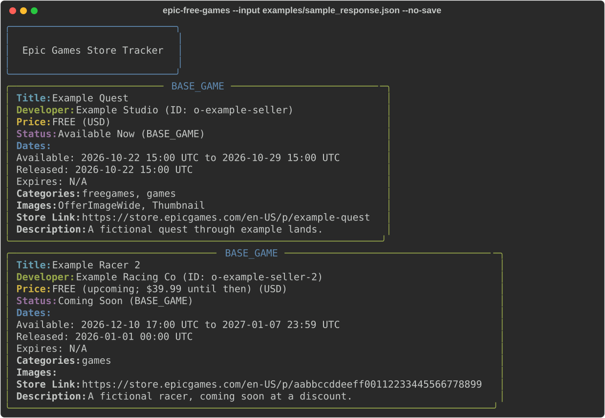
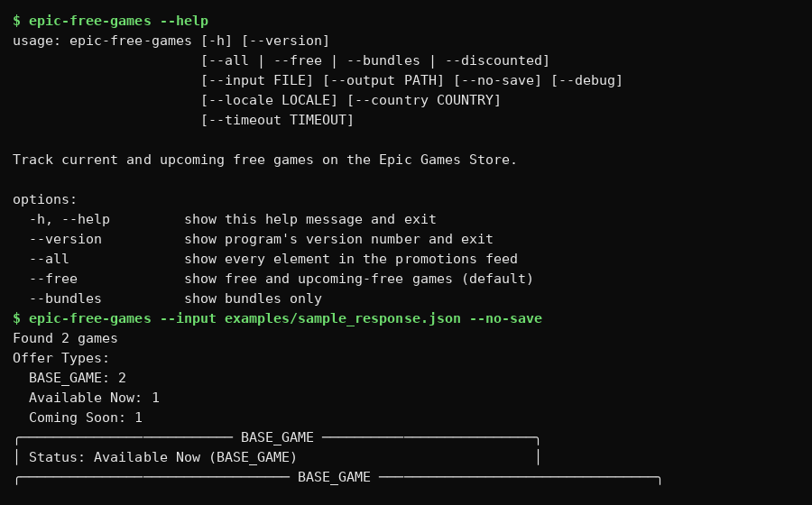
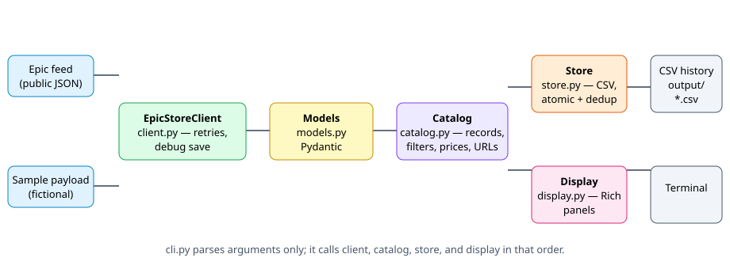

# Epic Free Games Tracker

[](https://github.com/enonymous1/epic-free-games-tracker/actions/workflows/ci.yml)
[](https://www.python.org/)
[](LICENSE)



## Description

Epic Free Games Tracker shows which games are free right now —
and which are coming free next — on the Epic Games Store, from
one command, with a CSV history that de-duplicates itself on
every run.

It reads Epic's public `freeGamesPromotions` JSON feed. It does
not scrape HTML pages, it needs no Epic account or API key, and
it is not affiliated with Epic Games.

## Prerequisites

- Python 3.10 or newer (`python --version`)
- `pip` (or `pipx`, recommended for CLI tools)
- Network access to `store-site-backend-static.ak.epicgames.com`
  for live runs. Offline runs work with `--input` (see below).
- No Epic account, API key, or browser login required.

## Installation

From a checkout (current, recommended until a PyPI release exists):

```bash
git clone https://github.com/enonymous1/epic-free-games-tracker.git
cd epic-free-games-tracker
pipx install -e .
# or, inside a virtual environment:
python -m venv .venv
source .venv/bin/activate   # Windows: .venv\Scripts\activate
pip install -e .
```

Verify:

```bash
epic-free-games --version
epic-free-games --help
```

> The package is not yet published on PyPI. Do not use
> `pip install epic-free-games-tracker` until a release announces it.

## Quick start



Try it without the network, on the fictional sample payload
shipped in `examples/`:

```bash
epic-free-games --input examples/sample_response.json --no-save
```

Then live, free games only (the default):

```bash
epic-free-games
```

That prints each game in a Rich panel and appends new or
changed rows to `./output/epic_free_games.csv` (relative to
where you run the command). Running it again adds nothing
unless something changed.

## Usage

| Flag | What it does |
| --- | --- |
| `--free` | Free now and upcoming-free games (default) |
| `--all` | Every element in the feed, including ones with no promotion |
| `--bundles` | Bundles only |
| `--discounted` | Discounted (but not free) games only |
| `--output PATH` | CSV history file (default `./output/epic_free_games.csv`) |
| `--no-save` | Print only, do not write the CSV |
| `--debug` | Also save the raw feed payload to `./debug_logs/` |
| `--input FILE` | Read a saved feed payload (JSON) instead of fetching |
| `--locale`, `--country` | Feed locale/country (defaults `en-US` / `US`) |
| `--timeout SECONDS` | HTTP timeout (default 30) |
| `--version` | Print the version |

```bash
epic-free-games --all --output output/all_games.csv
epic-free-games --bundles --no-save
epic-free-games --debug
python -m epic_free_games_tracker --free
```

Exit codes: `0` on success (including "no games found"), `1`
when the feed cannot be fetched or the CSV cannot be saved.
Errors go to stderr, so stdout stays pipeable.

## CSV history

One row per new or changed game, 35 columns: `title`, `id`,
`namespace`, `description`, `developer`, `developer_id`,
`original_price`, `discount_price`, `currency_code`,
`discount_percentage`, `price_type`, `effective_date`,
`viewable_date`, `expiry_date`, `start_date`, `end_date`,
`status`, `offer_type`, `is_bundle`, `bundle_items`,
`store_url`, `product_slug`, `thumbnail`, `images`,
`categories`, `tags`, `discount_rules`, `custom_attributes`,
`all_categories`, `all_tags`, `date_found`.

A row is added only when its id is new, or when its title,
price, status, or promotion dates changed since the *latest*
row for that id. Re-running with no changes adds zero rows.
`images`, `categories`, `tags`, and `discount_rules` are JSON
strings inside the CSV; `date_found` is UTC ISO-8601. Writes
are atomic (temp file + replace), so a failed run leaves the
previous history intact.


## How it works



One httpx client fetches the feed (retries transient 5xx and
429 responses, three attempts, honouring `Retry-After` with
backoff and jitter), Pydantic models validate every element,
each element becomes one flat record, and the record is
rendered (Rich) and/or saved (CSV, de-duplicated).

Two feed quirks worth knowing:

- **Store URLs use `urlSlug`.** That value is sometimes a hash,
  which is a valid Epic store slug. Building a slug from the
  title broke URLs in v1; the fallback chain is `urlSlug`, then
  the first segment of `productSlug`, then a title slug.
- **Discount % is computed from prices.** The promotion's
  `discountSetting` reports 0% for currently-free games, so
  copying it printed "PERCENTAGE 0%" for a free game. The raw
  settings are kept in `discount_rules`.

## Configuration

No config file is required. Environment handling is limited to
proxy/CA, resolved explicitly (httpx's `trust_env` parsing
crashes on some `NO_PROXY` values such as `[::1]`):

- `HTTPS_PROXY` / `HTTP_PROXY` — proxy URL, when set.
- `SSL_CERT_FILE` / `REQUESTS_CA_BUNDLE` / `CURL_CA_BUNDLE` —
  CA bundle path, first existing file wins.
- `NO_PROXY` — not yet honoured for the feed host; when a proxy
  is set, it is used for the feed host too. See
  [CHANGELOG.md](CHANGELOG.md) for the v2.0.1 notes.

## Local Development

```bash
python -m venv .venv
source .venv/bin/activate   # Windows: .venv\Scripts\activate
pip install -e ".[dev]"
ruff check .
ruff format --check .
mypy src tests
pytest -q --cov --cov-fail-under=80
```

Tests use mocked HTTP and the fictional sample payload only;
no test hits the network. CI runs a single lint job, a test
matrix (Ubuntu + Windows, Python 3.10–3.13) with a coverage
gate, and a weekly live smoke check (scheduled only, so a
feed outage cannot fail a pull request).

## Deployment

There is no server to deploy. Deployment for this project is:

1. **GitHub Release.** Tag a release (`git tag v2.0.1 &&
   git push origin v2.0.1`) and attach the release notes from
   `CHANGELOG.md`. CI gates the tag; it does not yet publish
   an artefact — add a release workflow when you want
   auto-attached zips.
2. **PyPI (optional, future).** Publish only after the v2.0.1
   installed-CLI fixes are in, and announce it in the README's
   Installation section at that point.
3. **Scheduled runs (for users).** Run the installed CLI daily
   and let the CSV accumulate:

   ```cron
   # Daily at 09:00, appending to the same history file
   0 9 * * * /path/to/epic-free-games --output /path/to/epic_free_games.csv
   ```

   On Windows, the same command goes in Task Scheduler
   (daily trigger, "Run whether user is logged on or not"
   only if the output path is absolute).

## Troubleshooting

| Symptom | Likely cause / fix |
| --- | --- |
| `Error fetching games` + exit 1 | Network, proxy, or feed down. Check `HTTPS_PROXY`/`NO_PROXY`; try `--input examples/sample_response.json --no-save` to prove the CLI itself works. |
| `No games found` + exit 0 | Feed returned no matching games for the filter. Try `--all`. |
| Output lands somewhere unexpected | You are on a pre-v2.0.1 build: defaults were package-relative. Pass `--output` explicitly, or upgrade. |
| CSV grows with duplicates | You are on a pre-v2.0.1 build with the first-row dedup bug. Upgrade; old duplicates will not be retroactively removed. |
| Feed shape changed | Epic changed the payload. Run with `--debug`, compare `debug_logs/epic_response_*.json` against `models.py`, and open an issue with the (redacted) payload. |

## Contributing

Issues and pull requests are welcome. Please include a
regression test for behaviour changes, run the four gate
commands in Local Development, and do not ship live store data
in fixtures — use the fictional sample payload.

## License

MIT. See [LICENSE](LICENSE).
